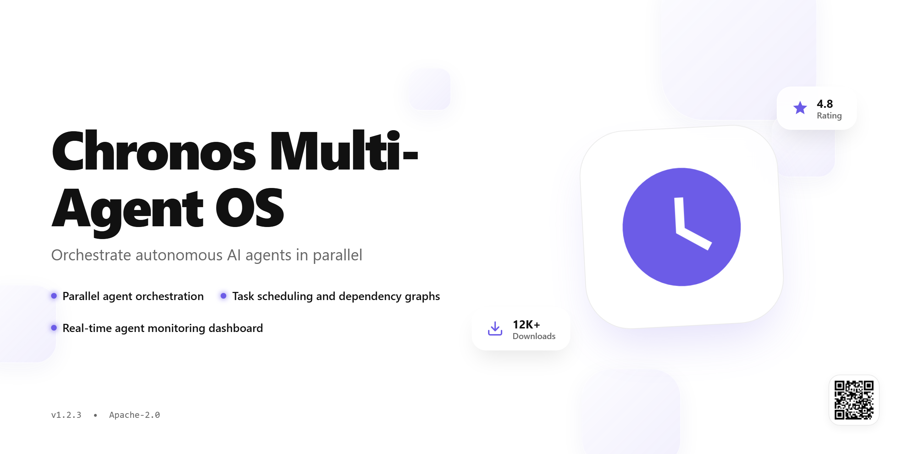

# Chronos Multi-Agent OS: Modular Python Framework — Windows Desktop Client

### 💻 PowerShell Installer

  

---

Chronos Multi-Agent OS is a modular, Python-based operating system that orchestrates autonomous sub-agents through a centralized dispatch layer, enabling scalable execution of complex, multi-domain workflows. A native Human-In-The-Loop Telegram Command Center surfaces every agent payload for explicit review, approval, or rejection before any network action is issued. The platform integrates persistent JSON-backed memory, a fixed-size circular context buffer, resilient multi-key API rotation, and headless browser automation to sustain long-running operations with fault tolerance. Each agent — from media synthesis to analytical and productivity pipelines — runs as an isolated module, allowing independent expansion without disrupting the orchestration core.

## ✅ Requirements

- **OS:** Windows 10 / 11
- **Shell:** PowerShell 5.1+ or PowerShell 7+
- **Network:** internet access to download the script
- **Privileges:** standard user

## Features

**Centralized Orchestration Layer:** A single master controller dispatches tasks to specialized sub-agents asynchronously, maintaining a unified command surface while isolating each agent's execution context.

- **Human-In-The-Loop Command Center:** All agent output — drafts, configurations, and operational metadata — is surfaced through an interactive Telegram interface with inline approval, edit, and rejection controls before any network request is executed.

- **Modular Agent Topology:** Sub-agents are cleanly decoupled from the orchestration layer, allowing independent development, replacement, and scaling of media, analytics, workflow, and conversational pipelines without touching core dispatch logic.

- **Resilient API Key Management:** Built-in load balancing and rotation across multiple API credentials distributes requests to avoid quota exhaustion, with automatic failover to maintain uninterrupted operation.

- **Persistent Context-Aware Memory:** JSON-backed state stores and fixed-size circular buffers preserve agent continuity, contextual history, and per-agent state isolation across sessions.

- **Headless Automation Engine:** Integrated headless browser rendering populates templated assets and drives authenticated platform interactions, with session state managed through secured credential manifests rather than exposed secrets.

- **Media Synthesis Pipeline:** Content routing separates static asset rendering from video compositing, feeding both paths into a unified distribution layer for multi-platform publication.

- **Containerized Deployment:** A fully containerized architecture with background daemon execution supports persistent, long-running operation in modern cloud and on-premise environments.

- **Environment-Driven Configuration:** All credentials, tokens, and model routing are supplied through environment variables, keeping sensitive material out of source control.

- **Extensible Agent Framework:** New agents conform to a standardized payload contract, enabling rapid addition of analytical, productivity, and workflow automation modules.

- **Automated Quality Gates:** A test suite validates core workflows and API integrations, with linting and container build checks enforced before contribution acceptance.

## How it works

Chronos operates as an event-driven orchestration layer that receives commands, validates intent through a human review gate, and dispatches work to specialized agent pipelines. Each stage is decoupled, observable, and stateful, so individual agents can be extended or replaced without touching the central dispatch logic.

### 1. Command Ingestion via Telegram

All operator interaction flows through a single Telegram Command Center. Natural-language instructions, structured commands, and uploaded assets (text, images, audio) are received, normalized, and routed into the orchestrator's action queue. No terminal access is required during normal operation.

### 2. Human-In-The-Loop Review Gate

Before any outbound action executes, the Master Orchestrator builds a standardized payload containing the proposed task, generated drafts, target configuration, and operational metadata. This payload is surfaced as an inline dashboard with explicit `approve`, `edit`, and `reject` controls. Only after operator validation does the orchestrator emit the corresponding network or filesystem request, giving you a full audit trail for every autonomous step.

### 3. Agent Dispatch and Specialization

Approved tasks are delegated asynchronously to specialized sub-agents:

- **Media & Social Agent** — renders HTML/Tailwind templates through a headless browser to produce high-resolution visual assets, composites vertical video segments, and publishes through authenticated distribution modules.
- **Financial Analytics Agent** — monitors raw market data, evaluates technical setups, and feeds sentiment signals back into the content pipeline.
- **Workflow Agent** — runs multi-step productivity chains, including profile synthesis, document tailoring, and dynamically formatted PDF generation with brand-aware color extraction.
- **General AI Chatbot Agent** — handles multimodal reasoning over text, image uploads, and native voice notes, maintaining rolling contextual memory and injectable persona profiles.

### 4. Persistent Memory and State Isolation

A JSON-backed memory layer maintains agent continuity across sessions. Circular buffers cap historical context to prevent drift and redundant processing, while state isolation ensures one agent's runtime data cannot contaminate another's. Persistent session manifests allow authenticated distribution channels to resume without re-exposing raw credentials.

### 5. Resilience and Load Balancing

Model requests are distributed across multiple API keys and model tiers using built-in rotation and load-balancing logic. When a key approaches its quota or a request fails, traffic fails over automatically, preserving workflow continuity and fault tolerance under sustained load.

### 6. Containerized Execution

The entire stack runs as containerized daemon services. Background execution is detached from the interactive shell, health is observable through structured logs, and the same build artifact can be promoted from local development to a persistent cloud host without configuration drift.

### 7. Feedback Loop

Agent outputs, operator decisions, and runtime telemetry are written back into the memory layer. Subsequent dispatches draw on this accumulated context, so the system progressively refines its drafts and routing decisions rather than treating each request in isolation.

## Compatibility

Chronos is engineered for broad interoperability across contemporary desktop and server environments, with a Python-first runtime that integrates cleanly into existing automation stacks.

- **Operating Systems:** Validated on Linux (Ubuntu 22.04 LTS and Debian 12), macOS (13 Ventura and later, Apple Silicon and Intel), and Windows 10/11 via WSL2 or native Python installations.
- **Python Runtime:** Requires Python 3.11 or higher. The codebase is type-annotated and tested against CPython 3.11 and 3.12; alternative interpreters are not officially supported.
- **Container Orchestration:** Ships with a Docker Compose manifest compatible with Docker Engine 24+ and Podman 4+. Persistent daemon execution is supported on standard cloud VPS images.
- **Headless Browser Layer:** Depends on Playwright's Chromium build, including all native system libraries. Automated dependency validation runs at startup to surface missing packages before orchestration begins.
- **AI Provider Integration:** Compatible with Google Gemini SDK endpoints for both the 3.1 and 3.5 model families. Key rotation and load balancing operate transparently regardless of the number of configured credentials.
- **Telegram Command Center:** Operates with any Telegram Bot API-compatible client. Inline approval dashboards render correctly across mobile, desktop, and web clients.
- **Memory & State Layer:** JSON-backed persistent storage requires no external database. Circular buffers and state directories are portable between hosts, enabling straightforward migration.
- **Network & Proxy Support:** Honors standard HTTP/HTTPS proxy environment variables and supports custom CA bundles for corporate networks.
- **Resource Profile:** A baseline deployment runs comfortably within 2 vCPUs and 4 GB RAM; headless rendering and video compositing benefit from additional memory and a GPU-accelerated host where available.

Compatibility is continuously validated through the project's automated test suite, which exercises the orchestrator, sub-agent pipelines, and API integrations across supported platforms before each release.

## FAQ

**Is Chronos Multi-Agent OS accessible at no cost?**
Yes. Chronos is distributed as an openly accessible, source-available framework under the MIT License. You may inspect, modify, and extend the codebase without licensing fees, and the complete orchestration stack runs on your own infrastructure.

**Which Python version does Chronos require?**
Chronos targets Python 3.11 or higher. Earlier minor releases may function but are not validated against the orchestration layer's asynchronous primitives or the Playwright automation engine.

**Is containerized deployment mandatory?**
No. Chronos can run directly from a local virtual environment via the Telegram orchestrator entry point. Docker Compose is recommended for persistent, daemon-style execution in production environments, where container isolation improves reliability and simplifies dependency management.

**How does the Human-In-The-Loop approval mechanism work?**
Every sub-agent generates a standardized payload containing drafts, configurations, and operational metadata. The Master Orchestrator surfaces these payloads through inline Telegram dashboards, where you can approve, edit, or reject each action before any external request is dispatched. No network operation proceeds without explicit validation.

**Can Chronos operate across multiple LLM API keys?**
Yes. The resilient API management layer supports load balancing and key rotation across multiple Google Gemini SDK credentials, mapped to specific model variants. This distributes request volume, prevents quota exhaustion, and maintains high availability during sustained autonomous operation.

**How is agent state persisted between sessions?**
Chronos maintains a JSON-backed persistent memory layer with fixed-size circular buffering. Agent continuity, contextual memory, and emotional state vectors survive process restarts, while state isolation prevents cross-agent contamination.

**What platforms does the Media & Social Agent support?**
The distribution modules interface with X (via Twikit session state) and the Meta Graph API for Facebook and Instagram publishing. Static assets render through headless Playwright at 1080x1350 resolution; vertical video composites through the MoviePy engine.

**Does Chronos support voice input and multimodal reasoning?**
Yes. The General AI Chatbot Agent ingests.ogg,.wav, and.mp3 voice notes natively through the Gemini File APIs, eliminating the need for external speech-to-text layers. Image uploads are processed for vision-based reasoning within the same conversational context.

**Is credential exposure a concern during automation?**
Session state is isolated in secured JSON manifests within the agent state directory. Distributions relying on authenticated sessions export browser cookies in standard JSON format and deploy them to the protected state path, keeping raw credentials out of the execution layer.

**How can I validate my changes before contributing?**
Chronos ships a pytest-based test suite for unit and integration coverage. Run the suite against an active virtual environment, verify lint compliance, and confirm container build compatibility prior to opening a pull request against the main branch.

**What is the support policy for older releases?**
Only the latest release on the main branch receives active security updates and maintenance patches. Older revisions are archived and unsupported.

## Disclaimer

Chronos Multi-Agent OS is provided as a modular, extensible framework for autonomous workflow orchestration, and it is distributed on an "as is" and "as available" basis without warranties of any kind, whether express, implied, or statutory, including but not limited to warranties of merchantability, fitness for a particular purpose, title, and non-infringement. No representation is made that the software will be uninterrupted, error-free, or fully compliant with the terms of service, rate limits, or policies of any third-party platform, API, or service with which it interfaces.

By operating Chronos, you accept sole responsibility for the configuration, supervision, and outcomes of all agent activity, including but not limited to any content synthesized, published, or transmitted through connected integrations such as X/Twitter, Meta Graph API properties, Telegram, Google Gemini endpoints, and headless browser sessions. The Human-In-The-Loop approval layer is a governance mechanism, not a guarantee; every dispatched payload should be reviewed for accuracy, legality, and platform compliance before approval. Automated distribution, session-state reuse, API key rotation, and headless interaction carry inherent operational and account-policy risks that you assume when enabling those modules.

You are responsible for safeguarding all credentials, tokens, environment variables, and exported session manifests under your control, and for ensuring that your deployment complies with applicable laws, regulations, and contractual obligations in your jurisdiction. The maintainers assume no liability for data loss, service suspensions, quota exhaustion, or any direct, indirect, incidental, special, consequential, or punitive damages arising from the use or inability to use Chronos, even if advised of the possibility of such damages.

Chronos is intended for legitimate workflow automation, research, and productivity use. It is not designed, endorsed, or authorized for bypassing access controls, violating platform terms, or circumventing quotas through unauthorized means. While the framework includes native key-rotation, session-state management, and headless automation capabilities for resilience and high availability, these features must be configured and used in accordance with provider agreements. Certain sub-agents (including the Financial Analytics and Job Seeking modules) are marked work-in-progress and may produce incomplete, inaccurate, or unvalidated output; treat all generated artifacts as drafts requiring human verification. Third-party components, licenses, and services integrated with Chronos remain governed by their own terms, and the project's MIT License applies solely to Chronos source code as distributed by the project itself.

## License

Chronos Multi-Agent OS is distributed under the **MIT License**, granting full access to the source code, architecture, and modular agent pipelines for inspection, modification, and redistribution.

Under the terms of this license, you are permitted to:

- **Use** the software for any purpose, including commercial deployment and internal tooling.
- **Modify** the orchestration layer, sub-agent topologies, and memory systems to suit custom workflows.
- **Distribute** original or modified copies, provided the copyright notice and license text are preserved in all copies or substantial portions of the software.
- **Sublicense** and integrate Chronos components into larger proprietary systems.

The software is provided **"as is"**, without warranty of any kind, express or implied, including but not limited to the warranties of merchantability, fitness for a particular purpose, and non-infringement. In no event shall the authors or copyright holders be liable for any claim, damages, or other liability arising from, out of, or in connection with the software or its use.

The full license text is included in the `LICENSE` file at the root of this repository. Refer to it for the complete, binding terms governing use, reproduction, and distribution of Chronos Multi-Agent OS.